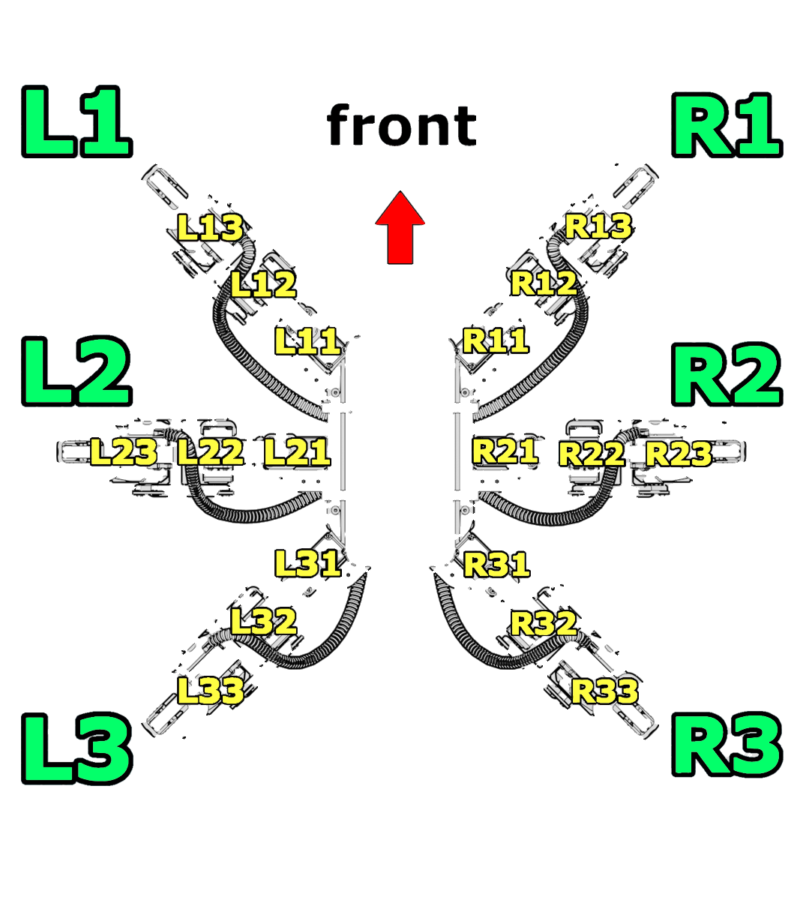
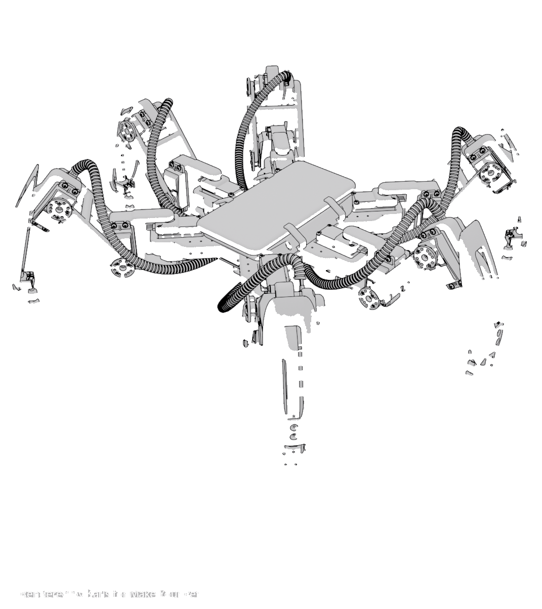

# 🕷️ Project SPIDEY — 18-DOF Bio-Inspired Autonomous Walking Hexapod Robot

<div align="center">


[](https://github.com/EngineerAbdullahBinZafar)
[](https://github.com/EngineerAbdullahBinZafar)
[](https://github.com/EngineerAbdullahBinZafar)
[](https://github.com/EngineerAbdullahBinZafar)
[](LICENSE)

**An industrial-grade bio-inspired biomimetic hexapod walking robot designed for rough terrain locomotion, omnidirectional trajectory tracking, and adaptive gait stabilization.**

[Keynote Defense Presentation](docs/Spidey_Cinematic_Defense_Keynote.html) • [Engineering Guide](docs/Hexapod_Complete_Guide.html) • [Master Script](docs/SPIDEY_DEFENSE_MASTER_SCRIPT.md)

</div>

---

## 📸 System Overview & Multi-Angle Hardware Views

<div align="center">

| Front Elevation (Sensor Array & Vision) | Overhead Plan (Coxa Angular Offsets) | Rear View (Power Bus & Manifold) |
| :---: | :---: | :---: |
|  |  |  |
| *Forward ultrasonic rangefinding & stereo eye bracket* | *Radially symmetric 60° coxa kinematics* | *Direct low-impedance high-current battery distribution* |

</div>

---

## ⚡ Technical Architecture & Kinematic Performance

| Subsystem | Specification / Empirical Benchmark | Architectural Details |
| :--- | :--- | :--- |
| **Kinematic Topology** | **18 Degrees of Freedom (3 DOF per leg $\times$ 6)** | Coxa (Pan, $\pm65^\circ$), Femur (Lift, $-45^\circ\text{ to }+65^\circ$), Tibia (Knee, $-90^\circ\text{ to }+45^\circ$) |
| **Gait Algorithms** | **Tripod (High Speed), Wave (Max Stability), Ripple** | 3-leg ground contact polygon maintained continuously; dynamic center-of-mass (CoM) projection inside support triangle |
| **Actuation Chain** | **18$\times$ Metal Gear MG996R Servomotors** | High-stall torque (11 kg·cm @ 6V), metal planetary geartrains, custom CNC aluminum servo horns |
| **Embedded Controller** | **Dual RP2040 / Pololu Micro-Maestro 24-Ch** | 125 MHz dual-core ARM Cortex-M0+, dedicated PWM hardware state-machines with microsecond jitter bounds |
| **Power Distribution** | **2S 7.4V 5200mAh LiPo + Dual 5V/20A Step-Down** | Split analog/digital ground planes, filtering capacitors per servo rail ($470\mu\text{F}\times6$) preventing brownouts |
| **Chassis Structure** | **High-tensile PETG & Aircraft 6061-T6 Aluminum** | Lightweight modular sandwich chassis; FEA-optimized ribs to withstand dynamic step impact loads |

---

## 🧬 Biological & Kinematic Engineering

<div align="center">

| Kinematic Joint Dissection & Exploded Leg Assembly | Servo Orientation & Coordinate Frame |
| :---: | :---: |
|  |  |
| *Modular 3-piece leg assembly: Coxa, Femur, and shock-absorbing Tibia tip* | *Right-hand coordinate frames $(X_0, Y_0, Z_0)$ and Denavit-Hartenberg parameter mapping* |

</div>

### Forward & Inverse Kinematics Formulation
For each leg $i \in \{1, \dots, 6\}$, given foot coordinates $(P_x, P_y, P_z)$ relative to coxa joint:
$$\theta_{\text{coxa}} = \operatorname{atan2}(P_y, P_x)$$
$$R = \sqrt{P_x^2 + P_y^2} - L_1, \quad S = \sqrt{R^2 + P_z^2}$$
$$\theta_{\text{femur}} = \operatorname{atan2}(P_z, R) + \arccos\left(\frac{L_2^2 + S^2 - L_3^2}{2 L_2 S}\right)$$
$$\theta_{\text{tibia}} = \arccos\left(\frac{L_2^2 + L_3^2 - S^2}{2 L_2 L_3}\right) - \pi$$

---

## 🛠️ Repository Directory Tree

```
project-spidey-hexapod/
├── cad_models/               # SolidWorks source files and 3D print STLs
├── firmware/                 # MicroPython, C++ and Pololu servo script configurations
│   ├── chica-config-2040.txt # Pinout and calibration offsets for RP2040
│   ├── component-layout.jpg  # Wiring architecture schematics
│   └── Chipo/                # STL parts (coxa-996, femur-996, tibia-996)
├── docs/                     # Interactive defense presentations and media
│   ├── assets/               # 50+ High-resolution technical photos and schematics
│   ├── Spidey_Cinematic_Defense_Keynote.html # HTML5 presentation engine
│   └── Hexapod_Complete_Guide.html           # Full engineering manual
└── README.md                 # System overview and engineering manifesto
```

---

## 👨‍💻 Author & Lead Engineer

**Abdullah Bin Zafar**  
*Mechatronics & Control Systems Engineer | Autonomous Robotics Specialist*  
- **GitHub:** [@EngineerAbdullahBinZafar](https://github.com/EngineerAbdullahBinZafar)  
- **Email:** abz.king.1.9.2003@gmail.com  
- **LinkedIn:** [Abdullah Bin Zafar](https://linkedin.com/in/abdullah-bin-zafar)
